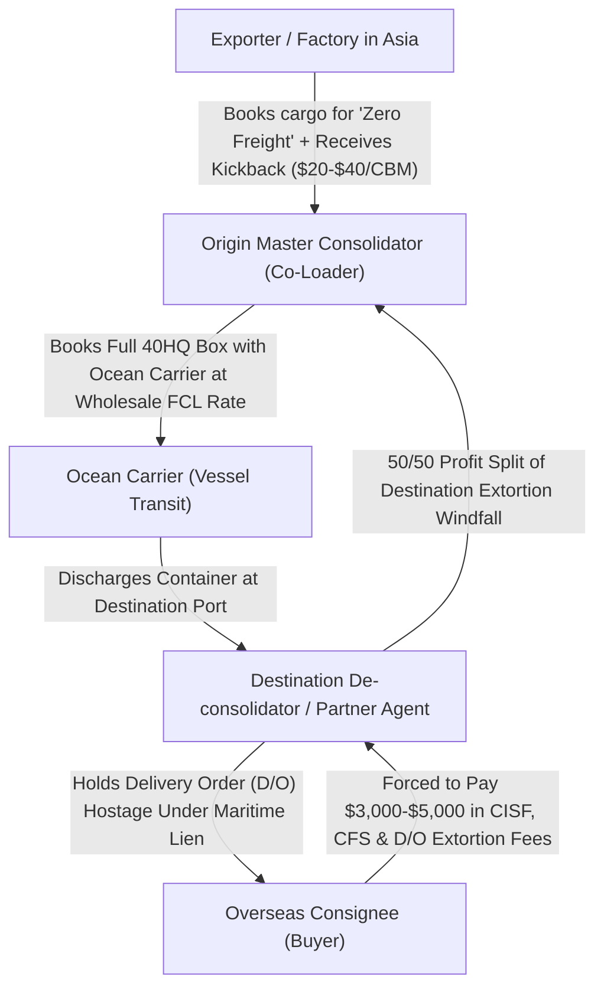
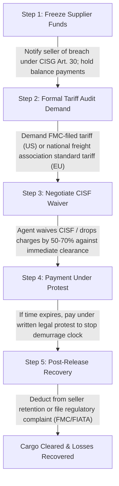

# The $300 CIF Shipping Quote That Invoiced $4,200 at the Port: A Buyer's Field Guide to LCL Destination Fee Extortion, the CISF Kickback, and the ICC (C) Insurance Blindspot

> **Author:** SourceRating Editorial Board | **Date:** 2026-11-21  
> **Category:** Packaging & Logistics | **Read Time:** 18 min read  
> **Canonical Path:** `docs/editorial/articles/cif-shipping-quote-destination-cisf-fee-trap-icc-cargo-insurance.md`  
> **Registered Slug:** `cif-shipping-quote-destination-cisf-fee-trap-icc-cargo-insurance`

---

## Executive Summary & Core Decision Matrix

An overseas procurement manager buying five crates of custom industrial valves, electrical motor drives, or structural brackets receives what looks like a commercial triumph: the manufacturer in Ningbo or Qingdao quotes **CIF Destination Port** (Rotterdam, Felixstowe, Hamburg, Los Angeles, or Sydney) with ocean freight billed at a token $50 per cubic metre (CBM)—or even "Zero freight, shipping included free."

Four weeks later, the vessel docks. The buyer does not receive a call from a reputable ocean carrier, but an "Arrival Notice and Freight Release Invoice" from an unfamiliar local break-bulk deconsolidator. To obtain the Delivery Order (D/O) and take custody of the goods, the consignee must pay **$4,200 in non-negotiable destination fees** on a $6,000 consignment. The bill lists items never mentioned in the proforma invoice: China Import Service Fee (CISF), De-consolidation Handling, Terminal Inbound Surcharge, and CFS Storage accumulating at $180 per day under a 48-hour free time clock.

When the buyer protests to the supplier, the supplier disclaims all responsibility: "Incoterms CIF only covers freight to your port; destination port clearance and handling are always for the buyer's account." When crates arrive with water damage from rough weather, the buyer discovers a second disaster: the CIF insurance certificate supplied by the seller covers only **Institute Cargo Clauses (C)**—a minimum-peril policy that excludes water damage, rough handling, container sweating, and rust.

This field guide dissects the mechanics of the zero-freight LCL kickback system, establishes the exact Incoterms 2020 legal risk boundary, provides the volumetric breakeven model where LCL becomes vastly more expensive than a dedicated 20ft container, audits the Institute Cargo Clauses (A vs B vs C), and arms buyers with enforceable contractual clauses and emergency port rescue protocols.

---

## 1. The Mechanics of the "Negative Freight" Kickback (退运费)

Why would an origin freight forwarder carry 6 CBM of heavy machinery parts halfway across the world for free or for $50? The answer lies in the underground economics of LCL (Less-than-Container Load) consolidation.

### The Co-Loading Consolidation Chain

1. **Origin Exporter Enticement:** The Chinese master consolidator approaches export factories and trading companies with an offer that seems impossible: zero ocean freight to European or American base ports, plus a cash rebate (known in Chinese logistics as **退运费** or "negative freight") of RMB 150 to RMB 300 ($20 to $40) per CBM paid *to the factory*.
2. **The FCL Arbitrage:** The consolidator gathers 60 CBM of LCL cargo from a dozen unsuspecting exporters, stuffs a single 40ft High Cube container, and pays the shipping line a wholesale contract rate of $2,200 for the ocean movement.
3. **The Destination Partner Monopoly:** The origin consolidator signs an exclusive agency agreement with a destination break-bulk handling agent. The agreement stipulates that the origin forwarder passes the cargo at zero origin cost, on the strict condition that the destination agent bills the consignee inflated local charges and splits the net proceeds 50/50.
4. **The Hostage Delivery Order:** Under maritime shipping law, the ocean carrier issues a Master Bill of Lading (MBL) to the consolidator. The consignee receives only a House Bill of Lading (HBL). To release the container from the terminal and obtain the Delivery Order (D/O) necessary for customs entry, the consignee must surrender the HBL to the destination agent. If the buyer refuses to pay the arbitrary fees, the agent withholds the D/O, triggering immediate storage penalties.

---

## 2. Incoterms 2020: The Cost and Risk Boundaries of CIF

The primary reason buyers fall into this trap is a fundamental misunderstanding of the **CIF (Cost, Insurance and Freight)** rule under the International Chamber of Commerce (ICC) Incoterms 2020.

| Incoterm 2020 | Delivery & Risk Transfer Point | Ocean Freight Paid By | Destination Terminal (THC/CFS) Paid By | Forwarder Nominated By | Primary Risk for Buyer |
| :--- | :--- | :--- | :--- | :--- | :--- |
| **EXW** (Ex Works) | At seller's factory/warehouse door | Buyer | Buyer | Buyer | Extreme: Buyer manages export customs & local transport abroad |
| **FCA** (Free Carrier) | At named inland terminal or port gate | Buyer | Buyer | Buyer (Nominated) | Low: Clean risk handoff; buyer controls ocean freight & destination charges |
| **FOB** (Free on Board) | Once cargo is on board vessel at origin port | Buyer | Buyer | Buyer (Nominated) | Low: Transparent freight, zero kickbacks, local forwarder accountability |
| **CFR** (Cost & Freight) | Once cargo is on board vessel at origin port | Seller | Buyer (unless in carriage contract) | Seller | High: Seller picks kickback forwarder; destination fee extortion |
| **CIF** (Cost, Insurance, Freight) | Once cargo is on board vessel at origin port | Seller | Buyer (unless in carriage contract) | Seller | High: Kickback forwarder + bare-minimum ICC (C) insurance trap |
| **DAP** (Delivered at Place) | At buyer's destination premises (uncleared) | Seller | Seller | Seller | Medium: Demurrage risk if import customs is delayed |
| **DDP** (Delivered Duty Paid) | At buyer's destination premises (cleared) | Seller | Seller | Seller | Severe: Seller forwarder tariff fraud / IOR non-compliance liability |

### Two Legal Cruxes in Incoterms 2020 CIF:
1. **The Double-Port Separation:** Under Incoterms 2020 CIF, the **place of delivery** is the port of shipment (when the goods are loaded on board the vessel), while the **named destination** is merely the endpoint of freight carriage. Risk transfers at the origin rail, *not* when the ship docks at your port.
2. **Article A6/B6 (Allocation of Costs):** The seller must pay the costs of freight and transport to the named destination. However, Article A6(b) explicitly provides that costs of unloading at the discharge port and destination terminal handling charges (DTHC/CFS) are for the *buyer's account*, unless such costs were included in the contract of carriage. Rogue forwarders deliberately strip destination handling from their carriage booking, legally dumping the entire cost onto the buyer.

---

## 3. Destination Port Invoice Audit: Legitimate Fees vs Extortion

When an arrival notice lands, procurement teams must immediately separate statutory carrier fees from concocted co-loader surcharges.

| Invoice Line Item | Legitimate Market Rate (Europe / North America) | Rogue Co-Loader Extorted Rate | Legitimacy Status | Defense / Action Protocol |
| :--- | :--- | :--- | :--- | :--- |
| **CISF / CISS** (China Import Service Fee) | **$0.00** (Invented charge; non-existent in carrier tariffs) | **$85 – $160 per CBM / W/M** | **FRAUDULENT / KICKBACK** | Demand FMC tariff filing (US) or reject under Incoterms A6; force seller reimbursement |
| **DTHC** (Destination Terminal Handling Charge) | $20 – $35 per CBM ($200–$350 flat for 20GP) | $80 – $140 per CBM | **INFLATED (300%+)** | Compare against published port terminal tariff; demand underlying wharfage receipt |
| **CFS Receiving / De-stuffing Fee** | $25 – $45 per CBM | $90 – $180 per CBM | **INFLATED (250%+)** | Require itemized break-bulk warehouse cost sheet; challenge non-standard line items |
| **Delivery Order (D/O) Issuance** | $60 – $100 flat per B/L | $200 – $450 flat per B/L | **INFLATED** | Standard documentation fee; challenge fees exceeding $120 |
| **Customs Turnover / Handover Fee** | $0.00 (or $30 if 3rd party broker used) | $150 – $300 flat | **PUNITIVE SURCHARGE** | Charged to penalize buyers who do not use the agent's in-house customs broker |
| **Port Security (ISPS / Clean Truck)** | $10 – $25 flat | $60 – $120 flat | **INFLATED** | Verify against carrier master bill of lading actual security pass-through |
| **CFS Storage / Demurrage** | 7–14 days free time; then $30–$50/day | 3 days free time; then $120–$250/day | **TRAP** | Ticking clock weaponized by delaying invoices until free days expire |

---

## 4. The Volumetric Breakeven: The 12–14 CBM Rule

A common mistake in industrial sourcing is assuming that Less-than-Container Load (LCL) is always cheaper than a Full Container Load (FCL) whenever the shipment volume is below the capacity of a 20ft dry box (~28–30 CBM).

Because LCL destination fees are billed **per Revenue Ton / CBM (Weight or Measurement, W/M)**, destination costs scale linearly. In contrast, FCL destination port terminal handling is a fixed lump sum per container.

### Mathematical Comparison Model (14 CBM / 4,500 kg Industrial Machinery Parts from Shanghai to Hamburg)

$$\text{Total Landed Logistics Cost} = \text{Ocean Freight} + \text{Origin Handling} + \text{Destination Port Charges} + \text{Customs Clearance}$$

#### Scenario A: LCL on CIF Terms (Supplier's 'Cheap' $40/CBM Freight)
- Ocean Freight (14 CBM × $40): **$560**
- CISF Destination Surcharge (14 CBM × $95): **$1,330**
- CFS De-stuffing & Handling (14 CBM × $55): **$770**
- Inflated Destination THC (14 CBM × $35): **$490**
- Delivery Order (D/O) Fee: **$250**
- Documentation & Port Security: **$140**
- Customs Handover Fee: **$180**
- **Total Freight & Port Charges: $3,720**

#### Scenario B: Dedicated 20ft Container (20GP FCL) on FOB Terms (Buyer's Nominated Forwarder)
- Ocean Freight (1 × 20GP flat): **$1,450**
- Origin Handling & Export Clearance: Paid by Seller under FOB
- Destination THC (Wharfage flat): **$320**
- Carrier D/O Fee: **$85**
- Port Security & Clean Truck Fee: **$45**
- Standard Destination CFS / De-stuffing: **$0.00** (Full container drayed directly to buyer warehouse)
- **Total Freight & Port Charges: $1,900**

> [!IMPORTANT]
> **The Takeaway:** Shipping 14 CBM inside a half-empty 20ft container saved **$1,820 (49%)** compared to shipping LCL on CIF terms. In addition, the buyer eliminated 10 days of deconsolidation waiting time, avoided mixed-cargo handling damage, and secured 14 days of free demurrage.
> 
> **Operational Rule of Thumb:** Whenever cargo exceeds **12 CBM** (or **8 metric tons**), always obtain a 20GP FCL quote from your nominated forwarder before agreeing to LCL.

---

## 5. Marine Cargo Insurance: The ICC (C) Blindspot

Under Incoterms 2020 CIF, the seller is legally obligated to procure marine cargo insurance. However, unless the purchase contract explicitly states otherwise, the seller is only required to purchase **Institute Cargo Clauses (C)**—the lowest and cheapest tier of maritime insurance established by the Lloyd's Market Association (LMA) and International Underwriting Association of London (IUA).

### Institute Cargo Clauses (A), (B), and (C) Peril Comparison

| Named Perils & Transport Events | Institute Cargo Clauses (C) | Institute Cargo Clauses (B) | Institute Cargo Clauses (A) [All Risks] |
| :--- | :---: | :---: | :---: |
| Fire or explosion | **Covered** | **Covered** | **Covered** |
| Vessel stranded, grounded, sunk or capsized | **Covered** | **Covered** | **Covered** |
| Overturning or derailment of land conveyance | **Covered** | **Covered** | **Covered** |
| Collision or contact of vessel with external object | **Covered** | **Covered** | **Covered** |
| Discharge of cargo at a port of distress | **Covered** | **Covered** | **Covered** |
| General Average sacrifice and jettison | **Covered** | **Covered** | **Covered** |
| Earthquake, volcanic eruption or lightning | EXCLUDED | **Covered** | **Covered** |
| Washing overboard by heavy seas | EXCLUDED | **Covered** | **Covered** |
| Entry of sea, lake or river water into hold or container | EXCLUDED | **Covered** | **Covered** |
| Total loss of package lost overboard or dropped during loading | EXCLUDED | **Covered** | **Covered** |
| **Rough handling / dropped crate by port crane** | **EXCLUDED** | **EXCLUDED** | **Covered** |
| **Container sweating / condensation / moisture damage** | **EXCLUDED** | **EXCLUDED** | **Covered** (subject to 4.3) |
| **Rust, oxidation, and discoloration during voyage** | **EXCLUDED** | **EXCLUDED** | **Covered** (subject to 4.3) |
| **Theft, pilferage, and non-delivery of cartons** | **EXCLUDED** | **EXCLUDED** | **Covered** |
| **Cargo shifting and crushing inside container during swell** | **EXCLUDED** | **EXCLUDED** | **Covered** |

### The Critical Exclusions in ICC (A) That Catch Buyers

Even under Institute Cargo Clauses (A) ("All Risks"), insurers routinely reject claims using the statutory General Exclusions in **Clause 4**:
1. **Clause 4.3 (Insufficiency or Unsuitability of Packing):** If an electrical control panel arrives soaked due to sea-spray or broken because wooden internal bracing sheared off, the insurer's surveyor will examine the crate. If the wood was sub-standard, strapping was inadequate, or moisture-barrier VCI foil and desiccant were omitted, the claim is denied in full.
2. **Clause 4.4 (Inherent Vice):** Natural rusting of unprotected bare steel surfaces.
3. **Clause 4.6 (Insolvency of Carrier):** Loss caused by bankruptcy or financial arrest of the shipowner.

### Essential Insurance Endorsements
When contracting CIF, the buyer must mandate:
- **Institute Cargo Clauses (A) (LMA/IUA)** for **110% of the CIF invoice value** in the contract currency.
- **Institute War Clauses (Cargo)** and **Institute Strikes Clauses (Cargo)**.
- **Institute Classification Clause:** Vessel must be classed by an IACS member (e.g., Lloyd's Register, DNV, ABS, Bureau Veritas) and not exceed 25 years of age.
- **Transit Clause (Warehouse-to-Warehouse):** Coverage must extend from the supplier's factory warehouse through destination port until delivery at the buyer's final project site.

---

## 6. Enforceable Contractual Protection Clauses

To eliminate destination fee extortion and insurance gaps, procurement contracts must incorporate rigorous bilingual terms.

### Clause 1: Prohibition of CISF and Destination Fee Indemnity (中英双语防坑条款)

> **English:**  
> "The Contract Price is based on [FOB / CIF named port of destination, Incoterms 2020]. The Seller expressly warrants that the ocean freight contracted by the Seller or its shipping agents does not contain any 'negative freight', freight rebates, or co-loading kickback arrangements. The Seller guarantees that neither the Seller, the carrier, nor any destination de-consolidator or agent shall levy any China Import Service Fee (CISF), China Import Surcharge (CISS), turnover fees, or any destination terminal fees exceeding the standard published carrier terminal tariff at the port of discharge.  
> If the consignee is billed any CISF, CISS, or unagreed destination surcharges to obtain the Delivery Order (D/O), the Seller shall unconditionally reimburse the Buyer within five (5) business days of receiving the invoice copy, or the Buyer shall have the legal right to deduct the full amount from any pending contract payment, warranty retention, or bank guarantee."
> 
> **中文对照：**  
> “合同价格基于【FOB / CIF 指定目的港，Incoterms 2020】。卖方明确保证，由其或其货运代理订舱的海运服务绝不包含任何‘负运费’、运费回扣或拼箱暗佣安排。卖方保证，卖方、承运人及其目的港拆箱代理均不得向买方收取中国进口服务费（CISF）、中国进口附加费（CISS）、单证交接费，或任何超出卸货港船公司公开公布标准费率的目的港杂费。  
> 若收货人为换取提货单（D/O）而被索要任何 CISF、CISS 或未经事先书面确认的目的港不合理附加费，卖方须在收到发票副本后五（5）个工作日内无条件向买方足额补偿，或买方有权直接从任何应付合同款项、质保金或银行保函中全额扣除等额款项。”

### Clause 2: Mandatory Marine Cargo Insurance Rider (海运一切险指定条款)

> **English:**  
> "Where the trade term is CIF or CIP, the Seller shall, at its own expense, procure marine cargo insurance coverage for not less than 110% of the CIF contract value, underwritten by a first-class international insurance company (rated A- or higher by Standard & Poor's or A.M. Best).  
> The policy shall be subject to the Institute Cargo Clauses (A) [All Risks], Institute War Clauses (Cargo), and Institute Strikes Clauses (Cargo), dated 01/01/2009 or latest revision. The insurance shall provide 'Warehouse to Warehouse' coverage, remaining in full force from the time the goods leave the factory warehouse until final physical delivery and unloading at the Buyer's designated job site or warehouse. The original insurance policy or negotiable certificate shall be delivered to the Buyer alongside the shipping documents."
> 
> **中文对照：**  
> “若贸易术语为 CIF 或 CIP，卖方须自费投保海运货物运输保险，投保金额不得低于 CIF 合同金额的 110%，且须由具备国际声誉的一流保险公司（标普或贝氏评级 A- 及以上）承保。  
> 保险条款必须严格适用英国伦敦保险人协会货物一切险条款《Institute Cargo Clauses (A)》、战争险条款《Institute War Clauses (Cargo)》及罢工险条款《Institute Strikes Clauses (Cargo)》（2009年版或最新修订版）。保单必须明确提供‘仓至仓’（Warehouse to Warehouse）全程保障，责任期间自货物离开制造工厂车间起，直至货物最终抵达买方指定工程现场或仓库完成卸载。正本保险单或可转让凭证须随同全套海运提单一同交付买方。”

---

## 7. Emergency Rescue Protocol: When Cargo Is Held Hostage

If an extortionate arrival notice has already been issued, follow this immediate escalation sequence:

1. **Leverage CISG Article 30 & 74 Immediately:** Under the UN Convention on Contracts for the International Sale of Goods (CISG Art. 30), the seller is legally bound to transfer title and deliver goods free from any third-party right or claim. Notify the seller in writing that an unauthorized third-party lien has been placed on the cargo due to their forwarder's kickback booking, and that all demurrage, legal costs, and consequential delays will be claimed as damages under CISG Art. 74.
2. **Demand Published Regulatory Tariff Filings:**
   - In the United States: All NVOCCs and freight forwarders are bound by Federal Maritime Commission (FMC) regulations (46 CFR Part 520). A forwarder cannot legally demand charges not published in their public automated tariff. Ask for their FMC Organization Number and the exact tariff rule governing each line item.
   - In Europe / UK: Demand proof of adherence to standard freight forwarding association rules (e.g., BIFA in the UK, FENEX in the Netherlands, DSLV in Germany) and require their audited break-bulk terminal agreement.
3. **Execute 'Payment Under Written Protest' (避免滞报金/仓储费吞噬货值):** Never engage in a multi-week stalemate while cargo sits in a CFS warehouse racking up $200/day. If negotiations stall and free time expires, tender payment accompanied by a formal legal letter: *"Payment tendered strictly under protest to mitigate escalating terminal storage, reserving all statutory rights to seek full restitution and regulatory investigation."*
4. **Initiate Regulatory Reporting:** File a complaint with the FMC Office of Consumer Affairs and Dispute Resolution Services (CADRS) in the US, or with FIATA / national commercial fraud bureaus for unfair business practices.

---

## 8. Pre-Procurement Freight & Insurance Audit Checklist

Before signing a purchase order or issuing an L/C, complete this 10-point operational checklist:

- [ ] **Trade Term Selected:** Preferred **FCA (named inland terminal/port)** or **FOB (port of loading)** using a buyer-nominated forwarder with an established destination service contract.
- [ ] **LCL Volume Check:** If cargo exceeds **12 CBM or 8 tonnes**, compare LCL quotes against a dedicated **20GP FCL** container.
- [ ] **Pre-Agreed Destination Tariff:** If CIF/CFR is unavoidable, require the seller's forwarder to provide a signed **Destination Tariff Schedule** confirming exact local charges prior to booking.
- [ ] **Anti-CISF Clause Inserted:** The purchase agreement incorporates Clause 1 indemnifying the buyer against CISF, CISS, and non-standard destination fees.
- [ ] **Insurance Level Specified:** If CIF/CIP, contract mandates **Institute Cargo Clauses (A) All Risks** at 110% CIF value, plus War and Strikes endorsements.
- [ ] **Packaging Standards Defined:** Contract specifies export crates meeting **ISPM 15**, moisture barrier foil (VCI), and desiccant standards to prevent Clause 4.3 insurance denial.
- [ ] **Bill of Lading Form Verified:** Specify ocean bill of lading format; confirm whether MBL or HBL will be issued and verify the destination release agent.
- [ ] **CFS Free Time Confirmed:** Mandate a minimum of **10 calendar days of free storage time** at the destination CFS in the booking confirmation.
- [ ] **Emergency Contact Established:** Secure direct email and telephone contacts for the origin forwarder's management, not just the sales representative.
- [ ] **Payment Linked to Clean Release:** Final supplier balance (10% to 20%) is held until the cargo is physically released from the destination port and inspected on site.

---

## Primary References and Regulatory Sources

1. **International Chamber of Commerce (ICC):** *Incoterms® 2020 Rules for the use of domestic and international trade terms*, ICC Publication No. 723E. Rules A6/B6 (Allocation of Costs) and CIF Delivery obligations. [https://iccwbo.org/business-solutions/incoterms-rules/](https://iccwbo.org/business-solutions/incoterms-rules/)
2. **Lloyd's Market Association (LMA) & International Underwriting Association (IUA):** *Institute Cargo Clauses (A), (B), (C)* (Clauses 01/01/2009 revision; CL382, CL383, CL384). [https://www.lmalloyds.com/lma/joint-cargo](https://www.lmalloyds.com/lma/joint-cargo)
3. **Federal Maritime Commission (FMC):** *Final Rule on Demurrage and Detention Billing Requirements* (46 CFR Part 541; Docket No. 22-04), clarifying billing practices and non-vessel-operating common carrier responsibilities. [https://www.fmc.gov/carrier-and-mto-demurrage-and-detention-rules/](https://www.fmc.gov/carrier-and-mto-demurrage-and-detention-rules/)
4. **United Nations Commission on International Trade Law (UNCITRAL):** *United Nations Convention on Contracts for the International Sale of Goods (CISG)*, Articles 30, 35, 74 regarding seller delivery obligations and breach damages. [https://uncitral.un.org/en/texts/salegoods/conventions/sale_of_goods/cisg](https://uncitral.un.org/en/texts/salegoods/conventions/sale_of_goods/cisg)
5. **International Federation of Freight Forwarders Associations (FIATA):** *Model Rules for Freight Forwarding Services and Port Clearance Protocols*. [https://fiata.org/](https://fiata.org/)
